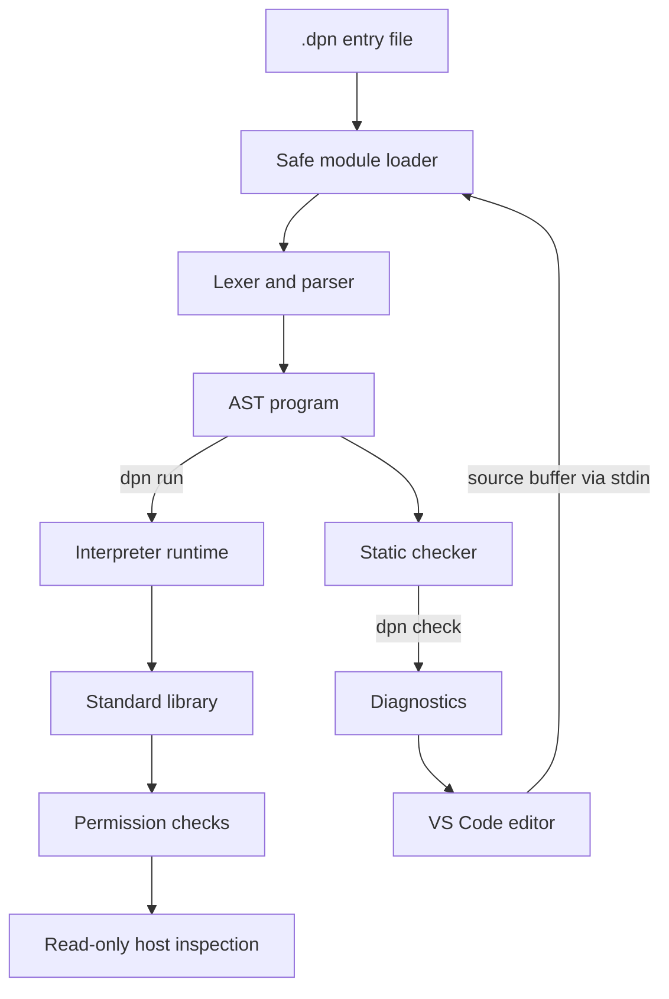

<div align="center">

# ◈ DPN LANGUAGE

### DEVELOP · PIONEER · NAVIGATE

**A Rust-powered, permission-restricted scripting language for software development and IT automation.**

[](https://github.com/DPN-Technology/DPN-Language/actions/workflows/rust.yml)
[](https://github.com/DPN-Technology/DPN-Language/actions/workflows/editor.yml)


**Version 0.8.0 · Experimental · DPN Technology**

</div>

> [!IMPORTANT]
> DPN is a functional **interpreter**, not a native-code compiler or a secure sandbox. Test and inspect scripts before running them. Read-only file access must be explicitly granted; native process execution and system changes are not exposed by the language.

## Mission control

| Start here | What you'll find |
|:--|:--|
| [Quick start](#quick-start) | Build, test and execute your first `.dpn` program |
| [Language features](#language-features) | Supported syntax and runtime behavior |
| [Architecture](#system-architecture) | Parser, checker, module loader and runtime flow |
| [Editor integration](docs/EDITOR_TOOLS.md) | VS Code setup, diagnostics and navigation |
| [Security model](docs/SECURITY.md) | Permissions, resource limits and trust boundaries |
| [Language guide](docs/LANGUAGE.md) | Syntax and expression reference |
| [Standard library](docs/STANDARD_LIBRARY.md) | Supported built-in APIs |
| [Module system](docs/MODULES.md) | Safe multi-file imports and dependency checks |

## Quick start

**Requirements:** Rust stable toolchain (install from [rustup.rs](https://rustup.rs)), Git, and optionally Node.js 22+ for editor checks.

```powershell
# In the repository directory
cargo test --all-targets
cargo build --release

# Windows
.\target\release\dpn.exe run examples\hello.dpn
.\target\release\dpn.exe check examples\modules.dpn

# Scaffold a new project
.\target\release\dpn.exe new my-first-dpn-app
```

Linux/macOS replace `dpn.exe` with `dpn` and use `/` path separators. The `dpn` executable is produced **after** building; this repository does not ship a prebuilt Windows binary.

### Your first `.dpn` program

```dpn
module DPN.Main

use lib.health;

fn main() {
    const app: string = "DPN Command Center";
    let devices: array = ["router", "server", "workstation"];

    print(app);
    print("Devices discovered: " + array.len(devices));
    print(health_label(system.cpu_count()));
}
```

See `examples/modules.dpn` and `examples/lib/health.dpn` for a complete working multi-file example. The snippet illustrates the language syntax; DPN does not yet perform device discovery automatically.

## System architecture



**Core components:** `src/lib.rs` (tokenizer, parser, AST, interpreter and built-ins), `src/checker.rs` (pre-execution semantic checking), `src/modules.rs` (restricted recursive imports), `src/main.rs` (CLI).

## Language features

| Area | v0.8 capabilities | Notes |
|:--|:--|:--|
| Variables | `let`, `const`, assignments | Constants cannot be reassigned |
| Types | `number`, `string`, `bool`, `array`, `nil`, `any` | Runtime checks and conservative static checks |
| Functions | Parameters, argument checking, return types | No closures or generics yet |
| Flow | `if` / `else`, `while`, `return` | Lexical block scoping |
| Collections | Array literals, indexes, nested arrays, helper functions | No map/object literals yet |
| Modules | `use lib.health;` and recursive imports | Imports merge into shared function namespace |
| Safety | Step and call-depth limits, optional read root | Not a complete hostile-code sandbox |
| IT APIs | OS, architecture, logical CPU count, limited file reads | No mutation or shell access |
| Editor | `.dpn` highlighting, completion, diagnostics and navigation | Source spans are incomplete |

## CLI reference

```text
dpn run   <file.dpn> [--allow-read <dir>]
dpn check <file.dpn> [--stdin]
dpn new   <project-name>
dpn version
dpn help
```

**`--stdin`** is designed for editors: pipe unsaved DPN source into the checker while leaving the saved file untouched. The entry file must exist on disk so the module loader can determine the project root.

### Permission model

```powershell
# No filesystem access is granted by default
dpn run examples\file_audit.dpn

# Grant read access to a specific directory only
dpn run examples\file_audit.dpn --allow-read .
```

File reads are limited in size and confined to the permitted canonical directory. Follow [SECURITY.md](docs/SECURITY.md) for limitations and threat-model assumptions.

## VS Code developer experience

The extension is in [`editors/vscode-dpn-language`](editors/vscode-dpn-language). It provides semantic checker diagnostics in Problems, native `.dpn` syntax support, local symbol navigation, built-in autocomplete, and hover help.

Use the **DPN: Run Current File** and **DPN: Check Current File** commands. Set `dpn.executable` to a compiled `dpn` binary and read [EDITOR_TOOLS.md](docs/EDITOR_TOOLS.md) for installation and current limitations.

## Build and verification gates

| Workflow | Coverage |
|:--|:--|
| **DPN Rust CI** | Clippy, tests and release builds across Ubuntu, Windows and macOS |
| **DPN Editor Checks** | Node syntax validation and VS Code extension manifest checks |
| **GitHub security scanning** | Subject to the repository's configured GitHub security features |

The badges above reflect actual GitHub Actions results; a passing badge does not mean the language is production-ready.

## Project map

```text
src/                    Rust interpreter, static checker, module loader and CLI
examples/               Runnable .dpn examples and local modules
tests/                  Rust integration tests and editor checks
docs/                   Language, types, security and architecture guidance
editors/vscode-dpn-language/
                        VS Code extension source
.github/workflows/       Cross-platform build, test and editor checks
```

## Roadmap

- **v0.8 (current):** Complete initial GitHub repository import; CLI buffer checking; VS Code diagnostics, completion, navigation and CI.
- **v0.9 (planned):** Accurate source spans and structured diagnostics; namespaced imports; better symbol analysis; first standalone language-server transport.
- **v1.0 (future):** Stabilized language spec, expanded standard library, hardened capability policy and documented compatibility contract after extensive real-world testing.

## Ownership and licensing

Copyright © DPN Technology. This repository currently includes the [MIT license](LICENSE). Anyone proposing a different licensing approach should review that file before publishing or redistributing code.